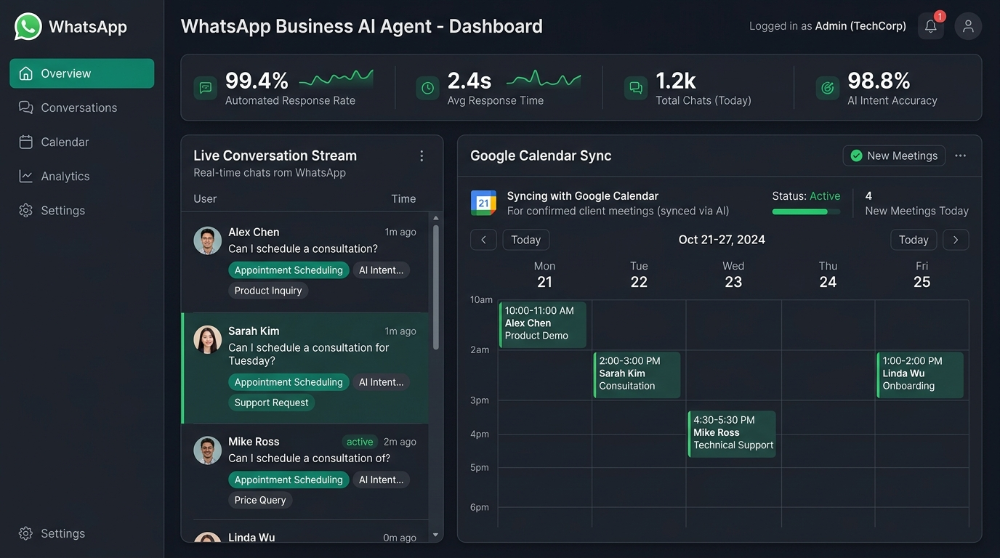

<div align="center">

# 🤖 WhatsApp Business AI Agent
### *Automated Customer Inquiries, Smart Appointment Scheduling & Meta Cloud API Integration*

[](https://python.org/)
[](https://developers.facebook.com/docs/whatsapp/cloud-api)
[](https://developers.google.com/calendar)
[](./LICENSE)

<br />

<p align="center">
  An enterprise-grade conversational AI assistant designed to automate high-volume customer communication on WhatsApp. Equipped with automated intent detection, instant answers to frequent queries, and autonomous meeting scheduling directly into Google Calendar.
</p>

[**Explore Architecture**](#-system-architecture) • [**Setup Guide**](#-setup--installation) • [**Report Bug**](https://github.com/Ahmad-Haassan/WhatsApp-Business-Agent/issues)

<br />



</div>

---

## 🌟 Key Features

### 1. ⚡ Intelligent Message Routing & Automated FAQs
* **Instant Intent Classification**: Identifies customer intentions (e.g., pricing, order status, technical support, meeting requests) and responds within seconds.
* **Contextual Conversations**: Generates natural, context-aware responses powered by AI instead of rigid scripted trees.
* **Human-in-the-Loop Hand-off**: Detects unresolved or sensitive queries and flags them for human support representatives.

### 2. 📅 Autonomous Google Calendar Scheduling
* **Natural Date & Time Extraction**: Understands user requests like *"Can we talk next Tuesday at 3 PM?"* and checks availability via Google Calendar API.
* **Auto-Event Creation**: Generates calendar invites with custom Google Meet links and sends automated confirmations to the client on WhatsApp.

### 3. 🛡️ Enterprise Meta Cloud API Integration
* **Webhook Architecture**: Securely processes incoming webhook payloads with cryptographic signature verification (`X-Hub-Signature-256`).
* **High Throughput**: Capable of handling concurrent incoming messages with asynchronous event workers.

---

## 🏗️ System Architecture

```text
[ Client (WhatsApp) ]
          │
          ▼
[ Meta WhatsApp Cloud API ]
          │ (HTTPS Webhook with Signature Verification)
          ▼
[ FastAPI / Flask Webhook Gateway ]
          │
          ├──► [ AI Intent Classifier & LLM Reasoning Engine ]
          │             │
          │             ▼
          │    (Context-Aware Response)
          │
          └──► [ Google Calendar API Service ]
                        │
                        ▼
               (Slot Reservation & Meet Link Generation)
                        │
                        ▼
[ Outbound Meta API Dispatcher ] ──► [ Customer Receives Confirmation ]
```

---

## 🛠️ Tech Stack

* **Language**: Python 3.10+
* **Messaging Platform**: Meta WhatsApp Business Cloud API
* **Scheduling**: Google Cloud Calendar API v3
* **AI & NLP**: Context-driven intent extraction & prompt orchestration
* **Backend**: Python HTTP Server / Webhook Listener

---

## 🚀 Setup & Installation

### 1. Clone the Repository
```bash
git clone https://github.com/Ahmad-Haassan/WhatsApp-Business-Agent.git
cd WhatsApp-Business-Agent
```

### 2. Configure Environment Variables
Create a `.env` file based on `.env.example`:
```bash
# Meta WhatsApp Cloud API Credentials
WHATSAPP_PHONE_NUMBER_ID="your_phone_number_id"
WHATSAPP_BUSINESS_ACCOUNT_ID="your_business_account_id"
WHATSAPP_ACCESS_TOKEN="your_meta_system_user_access_token"
WEBHOOK_VERIFY_TOKEN="your_custom_secure_verify_token"

# Google Calendar API Credentials
GOOGLE_CLIENT_ID="your_google_client_id"
GOOGLE_CLIENT_SECRET="your_google_client_secret"
GOOGLE_CALENDAR_ID="primary"

# AI / LLM Configuration
AI_API_KEY="your_api_key"
```

### 3. Install Dependencies
```bash
# Set up virtual environment
python -m venv venv
source venv/bin/activate  # On Windows: venv\Scripts\activate

# Install requirements
pip install -r requirements.txt
```

### 4. Run the Webhook Server
```bash
python main.py
```

Expose your local server via `ngrok` or deploy to Render/Railway, then configure your Meta App webhook callback URL to:
`https://your-domain.com/webhook`

---

## 📬 Connect & Author

- **Developer**: Ahmad Hassan
- **GitHub**: [@Ahmad-Haassan](https://github.com/Ahmad-Haassan)
- **Email**: [ahmad.hassan.dev@gmail.com](mailto:ahmad.hassan.dev@gmail.com)

---

## 📄 License

This project is licensed under the [MIT License](./LICENSE).
