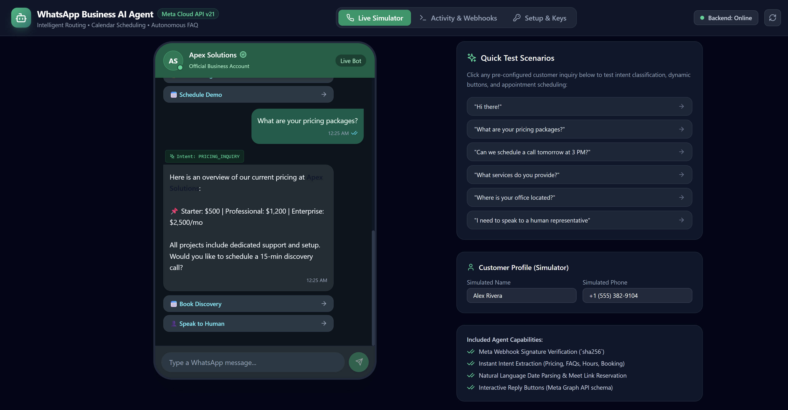

<div align="center">

# WhatsApp Business AI Agent
### *Automated Customer Inquiries, Smart Appointment Scheduling & Meta Cloud API Integration*

[](https://python.org/)
[](https://developers.facebook.com/docs/whatsapp/cloud-api)
[](https://developers.google.com/calendar)
[](./LICENSE)

<br />

<p align="center">
  A conversational AI assistant designed to automate customer communication on WhatsApp. Equipped with automated intent detection, instant answers to frequent queries and autonomous meeting scheduling directly into Google Calendar.
</p>

[**Explore Architecture**](#system-architecture) • [**Setup Guide**](#setup--installation) • [**Report Bug**](https://github.com/Ahmad-Haassan/WhatsApp-Business-Agent/issues)

<br />



</div>

---

## Key Features

### 1. Intelligent Message Routing & Automated FAQs
* **Instant Intent Classification**: Identifies customer intentions (such as pricing, order status, technical support or meeting requests) and responds within seconds.
* **Contextual Conversations**: Generates natural, context-aware responses powered by AI instead of rigid scripted trees.
* **Human-in-the-Loop Hand-off**: Detects unresolved or sensitive queries and flags them for human support representatives.

### 2. Autonomous Google Calendar Scheduling
* **Natural Date & Time Extraction**: Understands user requests like *"Can we talk next Tuesday at 3 PM?"* and checks availability via Google Calendar API.
* **Auto-Event Creation**: Generates calendar invites with custom Google Meet links and sends automated confirmations to the client on WhatsApp.

### 3. Enterprise Meta Cloud API Integration
* **Webhook Architecture**: Securely processes incoming webhook payloads with cryptographic signature verification (`X-Hub-Signature-256`).
* **High Throughput**: Capable of handling concurrent incoming messages with asynchronous event workers.

---

## 🏗️ System Architecture

```text
[ Client (WhatsApp) ]
          │
          ▼
[ Meta WhatsApp Cloud API ]
          │ (HTTPS Webhook with Signature Verification)
          ▼
[ FastAPI / Flask Webhook Gateway ]
          │
          ├──► [ AI Intent Classifier & LLM Reasoning Engine ]
          │             │
          │             ▼
          │    (Context-Aware Response)
          │
          └──► [ Google Calendar API Service ]
                        │
                        ▼
               (Slot Reservation & Meet Link Generation)
                        │
                        ▼
[ Outbound Meta API Dispatcher ] ──► [ Customer Receives Confirmation ]
```

---

## 🛠️ Tech Stack

* **Backend & API**: Python 3.10+ / 3.11, FastAPI, Uvicorn, Python-SocketIO
* **Messaging Platform**: Meta WhatsApp Business Cloud API (Graph API v21.0)
* **Scheduling**: Google Cloud Calendar API v3 with automatic Google Meet link creation
* **AI & NLP**: Google Gemini AI (`google-genai`) & autonomous heuristic intent routing
* **Frontend Simulator**: React 18, Vite, Tailwind CSS, Lucide Icons
* **Testing & Verification**: Automated Python test suite (`test_agent.py`)

---

## 🚀 Setup & Installation

### 1. Clone the Repository
```bash
git clone https://github.com/Ahmad-Haassan/WhatsApp-Business-Agent.git
cd WhatsApp-Business-Agent
```

### 2. Configure Environment Variables
Copy `.env.example` to `.env`:
```bash
cp .env.example .env
```
*(The project runs out-of-the-box in simulation mode. Fill in your Meta, Gemini and Google Calendar keys when ready to go live).*

### 3. Install Dependencies
```bash
# Python Backend Dependencies
pip install -r requirements.txt

# Client Simulator Dependencies
cd client
npm install
cd ..
```

### 4. Run the Application
You can run both the backend server and the interactive simulator with a single command:

**On Windows:**
```cmd
run_dev.bat
```

**Or manually in separate terminals:**
```bash
# Terminal 1: Python Webhook Server (http://localhost:8000)
python main.py

# Terminal 2: React Web Simulator (http://localhost:3000)
cd client
npm run dev
```

### 5. Run Automated Tests
```bash
python test_agent.py
```

Expose your local server via `ngrok` or deploy to Render/Railway, then configure your Meta App webhook callback URL to:
`https://your-domain.com/webhook`

---

## 📬 Connect & Author

- **Developer**: Ahmad Hassan
- **GitHub**: [@Ahmad-Haassan](https://github.com/Ahmad-Haassan)
- **Email**: [ahmad.hassan.dev@gmail.com](mailto:ahmad.hassan.dev@gmail.com)

---

## 📄 License

This project is licensed under the [MIT License](./LICENSE).
